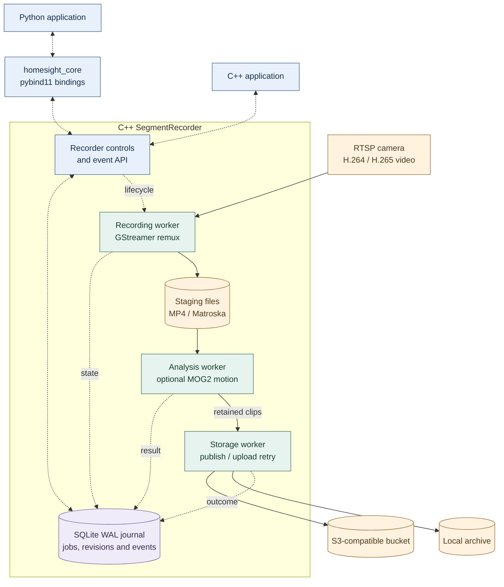
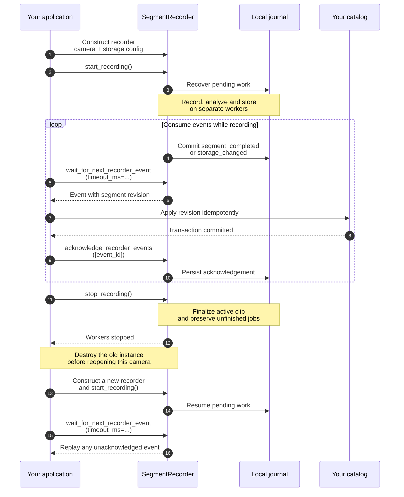

# User guide

Use HomeSight Core to record cameras, analyze saved video, and integrate recording events into your application. Start with the [recording example](index.md#record-a-camera) for a short recording to local storage.

- [Architecture](#architecture)
- [Application flow](#application-flow)
- [Installation](#installation)
- [Connecting to a camera](#connecting-to-a-camera)
- [Recording and recovery](#recording-and-recovery)
- [Recording events](#recording-events)
  - [Reading segment metadata](#reading-segment-metadata)
- [Motion and frame sampling](#motion-and-frame-sampling)
  - [Sample N frames per second](#sample-n-frames-per-second)
- [S3 storage](#s3-storage)
- [Using the C++ library](#using-the-c-library)

Run the shell commands in this guide from the repository root. Relative recording and staging paths in Python examples resolve from your application's working directory.

## Architecture

Each recorder owns one camera's recording pipeline and durable state. Use the Python bindings or call the C++ library directly; both control the same native implementation. In the generated HTML guide, scroll wide diagrams horizontally or use ⛶ to expand them.



Solid arrows show the video path; dotted arrows show API calls, lifecycle control, and journal updates. Recording, analysis, and storage run on separate workers: arrows between stages show work handoffs. The storage configuration selects either a local archive or an S3-compatible bucket.

Motion analysis is optional. When no-motion deletion is enabled, only a valid negative result deletes a clip; unknown results retain footage. Local quota enforcement can evict completed staging files, including pending uploads, while preserving uploaded S3 objects. Your application owns its catalog and any later AI processing.

## Application flow

Configure a recorder, start recording, and continuously consume its events. Commit each catalog revision before acknowledging the corresponding event. This sequence shows a typical run with retained clips:



Reading an event advances the current instance's delivery cursor; it does not acknowledge the event. `segment_completed` reports the analysis outcome; `storage_changed` reports a later storage success or failure. Storage work continues independently of your catalog transaction. After reopening the journal, unacknowledged events replay, so applying revisions must be idempotent.

Stopping waits for active bounded work but does not drain the backlog. A new recorder resumes unfinished jobs from the same staging directory and journal. See [recording and recovery](#recording-and-recovery) for shutdown deadlines and failure behavior.

## Installation

Install native development dependencies before building. Python 3.12 is selected by `.python-version`; `uv` can install it independently of the system Python.

Ubuntu 22.04:

```sh
sudo apt-get install build-essential cmake ninja-build pkg-config \
    libgstreamer1.0-dev libgstreamer-plugins-base1.0-dev \
    gstreamer1.0-plugins-base gstreamer1.0-plugins-good \
    gstreamer1.0-plugins-bad gstreamer1.0-plugins-ugly gstreamer1.0-libav \
    libopencv-dev libsqlite3-dev libcurl4-openssl-dev
uv sync
```

Fedora:

```sh
sudo dnf install gcc-c++ cmake ninja-build pkgconf-pkg-config \
    gstreamer1-devel gstreamer1-plugins-base-devel \
    gstreamer1-plugins-good gstreamer1-plugins-bad-free \
    opencv-devel sqlite-devel libcurl-devel
uv sync
```

Install the H.264/H.265 parsers, depayloaders and decoders provided by your distribution's GStreamer packages. Verify availability with `gst-inspect-1.0 rtspsrc`, `splitmuxsink`, `h264parse`, `h265parse`, `avdec_h264`, and `avdec_h265`. Recording remuxes video without decoding or re-encoding; audio is excluded. GStreamer 1.20+, CMake 3.22+, OpenCV core/imgproc/video, SQLite, and libcurl 7.75+ are required. The Python bindings require pybind11 3.0.4+ to support GIL release during native destruction. Builds use system native libraries; wheels are local builds, not portable manylinux bundles. When available, `h264timestamper` and `h265timestamper` reconstruct decode timestamps for reordered pictures. Segment durations are read from the finalized container rather than inferred from the split interval.

## Connecting to a camera

Supply the camera's RTSP URL through `CameraStreamConfig`. The camera must provide H.264 or H.265 video; recording excludes audio.

RTSP uses TCP by default, matching VLC's `:rtsp-tcp` option; do not append that VLC option to the URL. Credentials in the URL are passed separately to GStreamer, including passwords containing `@`. Percent-encoded credentials are decoded once, while encoded stream paths and query parameters are preserved. A genuine camera login rejection reports an RTSP authentication error.

## Recording and recovery

Defaults are ten-second MP4 segments, a 2 GiB local video allowance per camera, a separate 64 MiB journal allowance, and ten seconds for shutdown finalization. Use `container_format=core.VideoContainerFormat.matroska` for better recovery of interrupted recordings. A segment has a random stable ID independent of wall-clock timestamps. Start times use recorder-host UTC; durations use media timestamps. Configure the camera for closed GOPs and a keyframe interval of at most one second: segments split at keyframes, so actual durations can exceed the target.

`start_recording()`, `stop_recording(finalize_timeout_ms=10000)`, `is_recording()`, `get_config()`, and `get_recorder_statistics()` retain the synchronous recorder controls. One instance owns a camera's state directory for its lifetime, including while stopped. Destroy it before constructing another instance for the same directory. Keep a camera's staging directory and storage configuration stable across restarts. State directories require a local filesystem supporting POSIX locks, durable fsync and SQLite WAL; do not put journals on an object-store mount or share them across hosts.

`take_recorder_events(max_count=1024)` and `wait_for_next_recorder_event(timeout_ms=...)` advance an in-memory delivery cursor. They never acknowledge events. Every unacknowledged event replays after a new recorder instance opens the journal. Acknowledgement is idempotent. Sequences order events per camera; revisions order changes per segment. `segment_completed` includes an analysis result and pending storage, followed by `storage_changed` when storage succeeds or fails. `deleted_by_quota` reports local eviction. The compatibility `take_completed_segments()` and `wait_for_next_completed_segment()` APIs expose final outcomes and subsequent storage changes; durable consumers should use events and acknowledge their IDs.

Stopping dispatches EOS asynchronously and waits for the active segment until the configured finalization deadline. Workers stop taking new jobs and join after any current bounded decode or storage operation. Stop does not drain the backlog; therefore its total wall time can include the configured operation timeout after the finalization deadline. If a GStreamer callback exceeds the deadline, status becomes `failed` and its resources and camera lock remain owned until asynchronous cleanup finishes. Unfinished jobs remain in the journal. Unplayable interrupted files are retained with an `interrupted` outcome, and remain eligible for quota eviction. Restart reconciles recording, deletion, local-copy and upload intents. Network failures reconnect with bounded exponential backoff; local recording faults fail explicitly.

Quota enforcement deletes the oldest completed local recordings, including pending uploads, until their total bytes fit `local_video_allowance_bytes`. Active segments may temporarily exceed the allowance. Successful S3 uploads release their staging files by default. Local eviction preserves uploaded S3 objects and their URIs. Event backlog uses the separate journal allowance; exhaustion explicitly fails recording instead of dropping events. Consume and acknowledge events continuously, then restart recording after resolving exhaustion.

## Recording events

Use recorder events when your application maintains its own recording catalog:

```python
import homesight_core as core

config = core.SegmentRecorderConfig(
    camera=core.CameraStreamConfig(camera_name="front_door", rtsp_url=rtsp_url),
    storage=core.LocalDirectoryStorageConfig(root_directory="/data/homesight/stored"),
    staging_directory="/data/homesight/staging",
)
with core.SegmentRecorder(config) as recorder:
    while True:
        event = recorder.wait_for_next_recorder_event(timeout_ms=1000)
        if event is not None:
            persist_catalog_update(event)  # Commit your own transaction first.
            recorder.acknowledge_recorder_events([event.event_id])
```

`rtsp_url` and `persist_catalog_update()` are supplied by the application. An event contains `event_id`, per-camera `sequence`, `kind`, and a `completed_segment` snapshot. The snapshot includes `state_revision`, a stable `segment.segment_id`, recording times, media duration, motion result, storage outcome, URI, and errors. Apply each revision idempotently before acknowledging it.

The short README example leaves events unacknowledged. For a continuously running application, consume events and acknowledge them after persisting the corresponding catalog updates.

### Reading segment metadata

Use the configuration above and replace its recorder block with this example to inspect each segment revision. `persist_catalog_update(event)` remains your application's transaction, as in the preceding example.

```python
from datetime import UTC, datetime

import homesight_core as core

with core.SegmentRecorder(config) as recorder:
    while True:
        event: core.RecorderEvent | None = recorder.wait_for_next_recorder_event(timeout_ms=1000)
        if event is None:
            continue  # No event arrived before the timeout.

        completed: core.CompletedSegment = event.completed_segment
        segment: core.SegmentInfo = completed.segment
        start_time: datetime = datetime.fromtimestamp(segment.start_epoch_ms / 1000, tz=UTC)
        end_time: datetime = datetime.fromtimestamp(segment.end_epoch_ms / 1000, tz=UTC)

        print("Event:", event.event_id, event.sequence, event.kind.name)
        print("Segment:", segment.camera_name, segment.segment_id)
        print("Revision:", completed.state_revision)
        print("Start UTC:", start_time.isoformat())
        print("End UTC:", end_time.isoformat())
        print("Duration (seconds):", segment.duration_seconds)
        print("Size (bytes):", segment.file_size_bytes)
        print("Codec:", segment.video_codec)
        print("Storage:", completed.storage_outcome.name)
        print("Storage URI:", completed.storage_uri)  # May be None.
        print("Storage error:", completed.storage_error)

        motion: core.MotionAnalysisResult | None = completed.motion
        if motion is None:
            print("Motion: unavailable (for example, analysis was disabled)")
        else:
            print("Motion status:", motion.status.name)
            print("Has motion:", motion.has_motion)  # None means unknown, not False.
            if motion.status == core.MotionAnalysisStatus.valid:
                print("Peak changed area:", f"{motion.peak_changed_area:.1%}")
                print("Mean changed area:", f"{motion.mean_changed_area:.1%}")
                print("Motion/analyzed frames:", motion.frames_with_motion, motion.frames_analyzed)
            print("Motion diagnostic:", motion.error)
        print("Motion analysis error:", completed.motion_analysis_error)

        snapshot: dict[str, object] = completed.to_dict()
        print("Complete snapshot:", snapshot)
        persist_catalog_update(event)  # Apply the revision and commit before acknowledging.
        recorder.acknowledge_recorder_events([event.event_id])
```

The timestamps are Unix milliseconds converted to timezone-aware UTC datetimes. `duration_seconds` is the finalized media duration; `file_size_bytes` is the original finalized size, even if the staging file has since been removed. `video_codec` identifies H.264 or H.265. Use `storage_uri` to locate stored footage rather than assuming the original `staging_file_path` still exists.

A `segment_completed` event can have `storage_outcome=pending` and `storage_uri=None`. Later `storage_changed` events carry the same segment ID with a higher `state_revision` and the storage result, including a URI when available. A missing URI alone does not mean storage failed; inspect `storage_outcome` and `storage_error`. Process all event kinds, including quota eviction, and update your catalog by `(camera_name, segment_id)` only when the incoming revision is newer. Replayed or older revisions must not overwrite newer state; acknowledge each event after its transaction commits, including events already applied.

`motion=None` means no analysis result is available. When a result exists, `has_motion` is `True` or `False` only for `status=valid`; warm-up, insufficient data, and failure leave it `None`. Do not interpret unknown results as no motion. Changed-area values are fractions from 0 to 1, and frame counts describe analyzed samples rather than every video frame. The example displays these metrics only for valid results.

`completed.to_dict()` includes the nested segment and optional motion snapshot, storage state, revision, and diagnostics. It preserves Python `Path` and enum values, so convert those explicitly if your catalog requires JSON. For field types and method signatures, see the generated Python API for {py:class}`homesight_core.SegmentInfo`, {py:class}`homesight_core.CompletedSegment`, {py:class}`homesight_core.MotionAnalysisResult`, and {py:class}`homesight_core.RecorderEvent`.

## Motion and frame sampling

The examples below use `import homesight_core as core`.

```python
analyzer = core.SegmentMotionAnalyzer(core.MotionAnalysisParams())
result = analyzer.analyze_segment_motion(
    "/data/segment.mp4",
    continuity_id="connection-1",
    start_media_seconds=0,
)
frames = core.sample_clip_frames_from_segment(
    "/data/segment.mp4",
    frame_count=8,
    frame_width=224,
    frame_height=224,
)
assert frames.shape == (8, 224, 224, 3)
```

The analyzer maintains one MOG2 background model across chronological segments. Defaults: 320-pixel analysis width, 2 fps, 30-second warm-up, 120-frame history, variance threshold 16, automatic learning rate, and shadow exclusion. Motion requires at least 1% foreground in two evaluated frames. Status is `valid`, `warming_up`, `insufficient_data`, or `failed`; `has_motion` is `None` for every unknown status. Warm-up spanning any part of a segment keeps that entire segment unknown. `delete_segments_without_motion=True` deletes only valid negative results. Restart, reconnect, resolution changes, explicit `reset()`, and supplied media-time discontinuities reset the model. The standalone `analyze_segment_motion()` helper starts a fresh model on every call.

Sampled frames are evenly spaced in media time, center-cropped to the requested aspect ratio, and resized. The NumPy array owns its native RGB byte buffer through a capsule; it remains valid independently of the recorder or decoder. Blocking native operations release the GIL. CPU decoding is the default. `use_gpu_decoding=True` allows GStreamer's ranked hardware decoders, with CPU fallback; configure and inspect plugin ranks on the deployment host before claiming hardware acceleration.

### Sample N frames per second

Use `sample_clip_frames_from_segment_at_rate()` when downstream processing needs a sampling rate rather than a fixed total count:

```python
import numpy as np
from numpy.typing import NDArray

frames: NDArray[np.uint8]
timestamps_ms: list[int]
frames, timestamps_ms = core.sample_clip_frames_from_segment_at_rate(
    "/data/segment.mp4",
    frames_per_second=2,
    frame_width=224,
    frame_height=224,
)
print(frames.shape)  # (actual_count, 224, 224, 3), RGB uint8
print(timestamps_ms)  # Actual presentation times in milliseconds relative to the clip.
```

Each clip-relative second is divided into N equal half-open intervals, starting at zero. The first decoded frame in each occupied interval is selected. At 2 frames per second these intervals are `[0, 0.5)`, `[0.5, 1)`, `[1, 1.5)`, and so on. Sampling includes the final partial second: a 10.3-second clip can contribute a frame from its last 0.3 seconds. Empty intervals remain empty, so low-rate or irregular footage can return fewer frames; source frames are never duplicated or padded.

The returned timestamp list has one entry per RGB frame, in the same order. Values are actual decoded presentation times truncated to milliseconds, rather than scheduled target times. For a recorder-host UTC estimate, add an offset to the corresponding segment's `start_epoch_ms`. The existing `sample_clip_frames_from_segment()` still returns just an array with the requested total frame count.

Rate sampling decodes sequentially, center-crops, and resizes without modifying the source. It retains the existing dimension bounds of 1–8192 pixels, the default ten-second decode wall-time budget, optional GPU decoding, and independent NumPy buffer ownership. The positive integer rate does not guarantee a fixed output count. Actual output exceeding 4096 frames or 1 GiB of RGB pixels raises `InvalidConfigError`; it is never silently truncated. Increase `decode_timeout_seconds` for longer clips when needed. Missing or corrupt media, regressing presentation times, and exhausted decode time raise `SegmentDecodingError`.

Both samplers accept a local file path. For S3 recordings, first use `download_segment_to_local_file()` to obtain a local copy; the optional rate-sampling section in {download}`ExampleTrial.ipynb <../notebooks/ExampleTrial.ipynb>` demonstrates this flow. See {py:func}`homesight_core.sample_clip_frames_from_segment_at_rate` for the generated API reference.

## S3 storage

The example uses application-supplied `access_key` and `secret_key` values.

```python
storage = core.S3StorageConfig(
    bucket_name="camera-recordings",
    key_prefix="segments",
    endpoint_url="https://s3.example.net",
    use_path_style_addressing=True,
    credentials=core.S3Credentials(access_key_id=access_key, secret_access_key=secret_key),
)
```

Set `storage=storage` on the recorder config. Uploads run independently of motion analysis, retry with bounded exponential backoff, and use idempotent object keys. libcurl signs requests with AWS Signature V4. Explicit credentials and `AWS_ACCESS_KEY_ID`, `AWS_SECRET_ACCESS_KEY`, `AWS_SESSION_TOKEN` are supported; profile files and instance-role credential refresh are not implemented. Objects use single PUT requests (S3's 5 GiB single-object upload limit applies). Stage release happens after the durable storage event commits. `create_segment_storage(config)` also provides `store_segment_file(completed_segment)`, `download_segment_to_local_file(uri, destination)`, and `delete_stored_segment(uri)`. The complete segment/motion snapshot crosses the storage interface; uploads include identifying and motion metadata. Configuration `to_dict()` omits credentials and camera URLs.

## Using the C++ library

```sh
cmake --preset release
cmake --build --preset release
cmake --install build/release --prefix /path/to/install
```

```cmake
cmake_minimum_required(VERSION 3.22)
project(MyApplication LANGUAGES CXX)

find_package(HomesightCore CONFIG REQUIRED)
add_executable(my_application main.cpp)
target_link_libraries(my_application PRIVATE HomesightCore::homesight_core)
```

Public headers are under `homesight/`. Python bindings can be disabled with `-DHOMESIGHT_BUILD_PYTHON_BINDINGS=OFF`; standalone presets do this by default. Disable S3 with `-DHOMESIGHT_ENABLE_S3_STORAGE=OFF`. See the [development guide](development.md#build-compatibility-and-sanitizers) for build verification and sanitizer presets.

AI requests, embeddings, vector storage, and search belong in the application or a separate Python module. HomeSight Core supplies recording, motion analysis, frame sampling, and storage.
